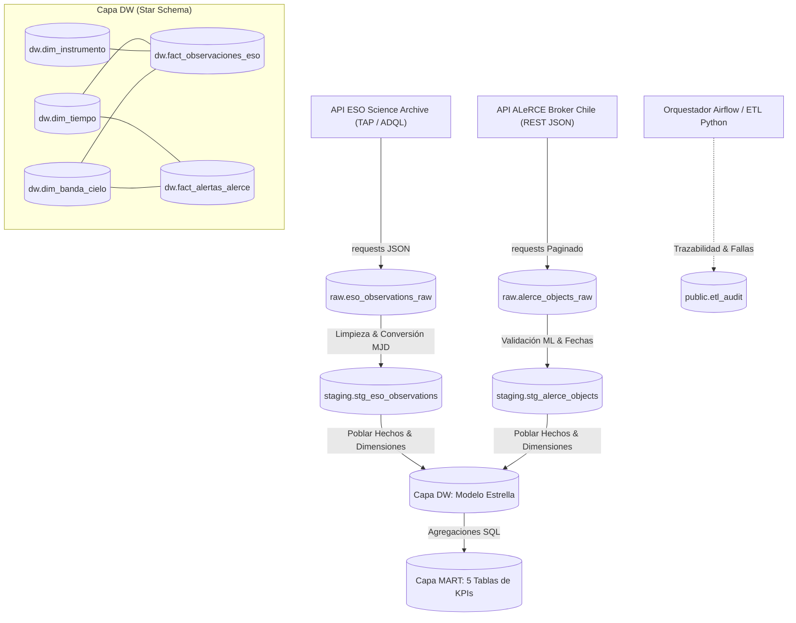
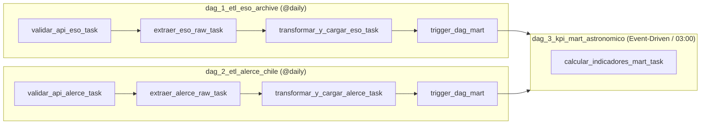

# Pipeline ETL y Data Warehouse Astronómico en Chile (ESO & ALeRCE)
**Asignatura:** INF-522 — Gestión II (Sistemas de Información y Data Warehousing)  
**Institución:** Universidad Católica del Maule (UCM)  
**Carrera:** Ingeniería Civil Informática  
**Docentes:** Natalia Morales | Sebastián Farías  
**Evaluación 2 (35%):** Proyecto Grupal de Extracción, Transformación, Carga y Orquestación  
**Repositorio Oficial:** [https://github.com/Francoisere/Gestion2-ESO](https://github.com/Francoisere/Gestion2-ESO)

---

## 🌌 1. Resumen y Contexto del Proyecto

Chile concentra más del 50% de la capacidad de observación astronómica mundial gracias a la excepcional calidad de sus cielos en el Desierto de Atacama. Sin embargo, los telescopios de clase mundial tienen un altísimo costo de operación y una sobredemanda de tiempo nocturno, mientras que el cielo nocturno produce millones de alertas de eventos transitorios (supernovas, estrellas variables, agujeros negros).

Este proyecto implementa una **solución integral de Inteligencia de Negocios y Data Warehousing** para medir la eficiencia operacional, la productividad de captura y la capacidad de seguimiento observacional en Chile, cruzando datos de los telescopios de **ESO en Chile** con las alertas procesadas por el broker chileno **ALeRCE**.

---

## 📡 2. Fuentes de Datos Abiertas de Chile y Justificación Territorial

Cumpliendo al 100% con la exigencia de utilizar APIs públicas de datos abiertos generados en territorio nacional obtenidas mediante código:

### 1. API 1: ESO Science Archive — Servicio TAP (`ivoa.ObsCore`)
* **Justificación Territorial en Chile:** El 100% de las instalaciones y telescopios del Observatorio Europeo Austral operan en territorio chileno bajo tratados con el Estado de Chile:
  * **Cerro Paranal (Región de Antofagasta):** Very Large Telescope (VLT) y VLTI.
  * **La Silla (Región de Coquimbo):** Telescopios de 3.6m (HARPS, NIRPS) y New Technology Telescope (NTT).
  * **Llano de Chajnantor (Región de Antofagasta):** Radiotelescopio ALMA y APEX.
* **Endpoint Síncrono TAP:** `https://archive.eso.org/tap_obs/sync`
* **Protocolo:** IVOA TAP (Table Access Protocol) mediante consultas **ADQL** (Astronomical Data Query Language).
* **Parámetros:** `REQUEST=doQuery&LANG=ADQL&FORMAT=json&QUERY=...`
* **Atributos Clave:** `obs_id`, `facility_name`, `instrument_name`, `dataproduct_type`, `calib_level`, `t_min` (MJD), `t_exptime`, `access_estsize`, `s_ra`, `s_dec`.

### 2. API 2: ALeRCE Broker API (Centro de Modelamiento Matemático / MAS Chile)
* **Justificación Territorial en Chile:** ALeRCE (*Automatic Learning for the Rapid Classification of Events*) es una plataforma científica e infraestructura chilena desarrollada por la **Universidad de Chile (CMM)**, el **Instituto Milenio de Astrofísica (MAS)**, la **Universidad de Concepción** y la **Fundación Data Observatory**, financiada por ANID.
* **Endpoint REST:** `https://api.alerce.online/ztf/v1/objects`
* **Protocolo:** REST API abierta con respuesta JSON, soporte de paginación (`page`, `page_size`) y ordenamiento por `lastmjd DESC`.
* **Atributos Clave:** `oid`, `class`, `classifier`, `probability`, `ndet`, `lastmjd` (MJD), `meanra`, `meandec`.

---

## 🔗 3. Campos de Cruce y Modelo Conceptual

| Dimensión de Cruce | Campo en ESO (API 1) | Campo en ALeRCE (API 2) | Regla de Transformación en Python / SQL | Clave en DW |
| :--- | :--- | :--- | :--- | :--- |
| **Temporal** | `t_min` (MJD) | `lastmjd` / `firstmjd` (MJD) | $Fecha = \text{1858-11-17} + \text{MJD (días)}$ | `dw.dim_tiempo(fecha_id)` |
| **Espacial** | `s_dec` (Grados) | `meandec` (Grados) | Discretización en franjas regulares de $10^\circ$: $\lfloor Dec / 10 \rfloor \times 10 \text{ a } \lfloor Dec / 10 \rfloor \times 10 + 10$ | `dw.dim_banda_cielo(banda_sk)` |

---

## 🏛️ 4. Arquitectura de 4 Capas en PostgreSQL



1. **`raw` (Inmutable):** Payloads `JSONB` crudos tal como llegan de las APIs (`raw.eso_observations_raw` y `raw.alerce_objects_raw`).
2. **`staging` (Limpia y Tipada):** Depuración, tipado estricto, imputación y enriquecimiento (`staging.stg_eso_observations` y `staging.stg_alerce_objects`).
3. **`dw` (Modelo Estrella):** 
   * Dimensiones: `dw.dim_tiempo`, `dw.dim_instrumento`, `dw.dim_banda_cielo`.
   * Hechos: `dw.fact_observaciones_eso` y `dw.fact_alertas_alerce`.
4. **`mart` (Indicadores):** 5 tablas de KPIs agregados con métricas de gestión.
5. **`public.etl_audit`:** Auditoría de cada ejecución (DAG, run_id, filas leídas, filas cargadas, % de nulos, duración y estado).

---

## 🔄 5. Orquestación en Apache Airflow (3 DAGs Desacoplados)



* **Sin credenciales en código:** Conexión `postgres_dw` configurada en Airflow Connections; URLs en Airflow Variables (`eso_api_url`, `alerce_api_url`).
* **Tolerancia a Fallas:** `retries=2`, `retry_delay=timedelta(seconds=15)`, `execution_timeout=timedelta(minutes=5)`.
* **Callback Automático:** `on_failure_callback = registrar_falla_audit` registra caídas en `public.etl_audit`.

---

## 📊 6. Los 5 Indicadores de Gestión (Esquema `mart`)

| # | Indicador | Objetivo / Decisión | Fórmula Matemática | Fuente | Periodicidad | Meta / Umbral |
| :-: | :--- | :--- | :--- | :--- | :--- | :--- |
| **1** | **Horas Efectivas de Exposición Diaria** | Medir el aprovechamiento nocturno en telescopios de ESO en Chile por instrumento. | $\frac{\sum \text{tiempo\_exposicion\_seg}}{3600}$ | ESO (`fact_obs`) | Diaria | $\ge 8.0 \text{ hrs}$ conjuntas por noche |
| **2** | **Volumen de Datos Generados (GB/día)** | Dimensionar la carga de almacenamiento y transferencia de red digital. | $\frac{\sum \text{tamano\_estimado\_mb}}{1024}$ | ESO (`fact_obs`) | Diaria / Mensual | Alerta si supera $500 \text{ GB/día}$ |
| **3** | **Tasa de Calibración Avanzada** | Evaluar la calidad de datos científicos procesados entregados a astrónomos. | $\frac{\text{COUNT}(\text{calib} \ge 2)}{\text{COUNT}(*)} \times 100$ | ESO (`fact_obs`) | Semanal / Mensual | $\ge 75\%$ en nivel ciencia |
| **4** | **Índice de Confianza en Alertas (ALeRCE)** | Evaluar la certidumbre del clasificador de Machine Learning chileno. | $\frac{\text{COUNT}(\text{prob} \ge 0.70)}{\text{COUNT}(*)} \times 100$ | ALeRCE (`fact_alertas`) | Diaria | $\ge 60\%$ de alertas con prob $\ge 0.70$ |
| **5** | **Cobertura de Seguimiento por Banda (Cruce)** | Identificar zonas con déficit de seguimiento observacional frente a alertas. | $\frac{\text{Minutos Exposición ESO en Banda } i}{\text{N}^\circ \text{ Alertas ALeRCE en Banda } i}$ | Cruce ESO + ALeRCE | Diaria / Semanal | $\ge 5.0 \text{ min/alerta}$ en Hemisferio Austral |

---

## ⚡ 7. Guía de Reproducción Rápida

### Opción A: Ejecución mediante Suite de Pruebas CLI (Recomendado para verificación local)

1. Clonar el repositorio:
   ```bash
   git clone https://github.com/Francoisere/Gestion2-ESO.git
   cd Gestion2-ESO
   ```

2. Instalar dependencias en Python (3.10 o superior):
   ```bash
   pip install -r requirements.txt
   ```

3. Asegurar que PostgreSQL esté corriendo en el puerto 5432 con base de datos `dw_astronomia` (o iniciar el contenedor de postgres):
   ```bash
   docker run -d --name postgres_dw -e POSTGRES_PASSWORD=postgres -e POSTGRES_DB=dw_astronomia -p 5432:5432 postgres:15
   ```

4. Ejecutar el pipeline completo de principio a fin:
   ```bash
   python -m src.pipeline_runner run-all
   ```

5. Ejecutar la **Demostración de Falla Controlada** (simula error, reintentos, auditoría FAILED, aislamiento y recuperación):
   ```bash
   python -m src.pipeline_runner demo-failure
   ```

6. Ver los registros de auditoría y los KPIs:
   ```bash
   python -m src.pipeline_runner show-audit
   python -m src.pipeline_runner show-kpis
   ```

### Opción B: Ejecución Completa con Docker Compose y Apache Airflow

1. Levantar el stack completo (PostgreSQL + Apache Airflow):
   ```bash
   docker-compose up -d
   ```
2. Acceder a la interfaz web de Airflow: `http://localhost:8080` (Usuario: `admin`, Contraseña: `admin`).
3. Habilitar y ejecutar en orden: `dag_1_etl_eso_archive` y `dag_2_etl_alerce_chile`.

---

## 🎤 8. Protocolo de Demostración de Falla en Vivo (Exposición de 8 min)

Para la presentación ante la comisión evaluadora:
1. En la interfaz de Airflow (Admin $\rightarrow$ Variables), cambiar temporalmente `eso_api_url` a una URL inválida: `https://archive.eso.org/tap_obs/url_rota_demo`.
2. Ejecutar `dag_1_etl_eso_archive` y `dag_2_etl_alerce_chile`.
3. Mostrar cómo la tarea de validación entra en estado **up_for_retry** (amarillo), reintenta 2 veces cada 15 segundos y marca **failed** (rojo).
4. Ejecutar en PostgreSQL: `SELECT * FROM public.etl_audit ORDER BY audit_id DESC LIMIT 5;` para demostrar que el callback registró la caída con estado `FAILED`.
5. Mostrar cómo `dag_2_etl_alerce_chile` y `dag_3_kpi_mart_astronomico` terminaron en verde (**success**), demostrando el aislamiento total de los DAGs.
6. Restaurar la URL correcta en Airflow Variables, presionar **Clear Task** sobre la tarea fallida y mostrar la recuperación exitosa e idempotente.

---

## 📁 9. Estructura de Entregables del Repositorio

```
├── .env.example                                      <- Variables de entorno de referencia
├── .gitignore                                         <- Filtros de exclusión de git
├── docker-compose.yml                                 <- Despliegue de PostgreSQL y Apache Airflow
├── requirements.txt                                   <- Librerías Python necesarias
├── README.md                                          <- Documentación técnica y guía de reproducción
├── sql/
│   ├── ddl_estructura.sql                            <- DDL de las 4 capas y public.etl_audit
│   └── kpis_mart.sql                                 <- Consultas SQL para los 5 KPIs del Mart
├── dags/
│   ├── dag_1_etl_eso_archive.py                      <- DAG 1: Extracción y carga ESO Chile
│   ├── dag_2_etl_alerce_chile.py                     <- DAG 2: Extracción y carga ALeRCE Broker
│   └── dag_3_kpi_mart_astronomico.py                 <- DAG 3: Refresco de KPIs en el Mart
├── src/
│   ├── config.py                                     <- Conexión y variables sin credenciales
│   ├── extract_eso.py                                <- Extracción TAP ADQL ESO Science Archive
│   ├── extract_alerce.py                             <- Extracción REST paginada ALeRCE Chile
│   ├── transform.py                                  <- 6 transformaciones de datos documentadas
│   ├── load.py                                       <- Carga e idempotencia (ON CONFLICT)
│   ├── audit.py                                      <- Logger hacia public.etl_audit
│   ├── kpi_calculator.py                             <- Ejecutor SQL del esquema mart
│   └── pipeline_runner.py                            <- CLI para pruebas locales y demo de falla
├── informe/
│   ├── generar_informe_pdf.py                        <- Script generador del informe en ReportLab
│   └── Informe_INF522_Gestion_Datos_Astronomicos.pdf  <- Informe técnico formal completo
└── presentacion/
    ├── generar_presentacion_pptx.py                  <- Script generador de la presentación
    └── Presentacion_INF522_Gestion_Datos_Astronomicos.pptx <- Presentación de apoyo (11 láminas)
```
